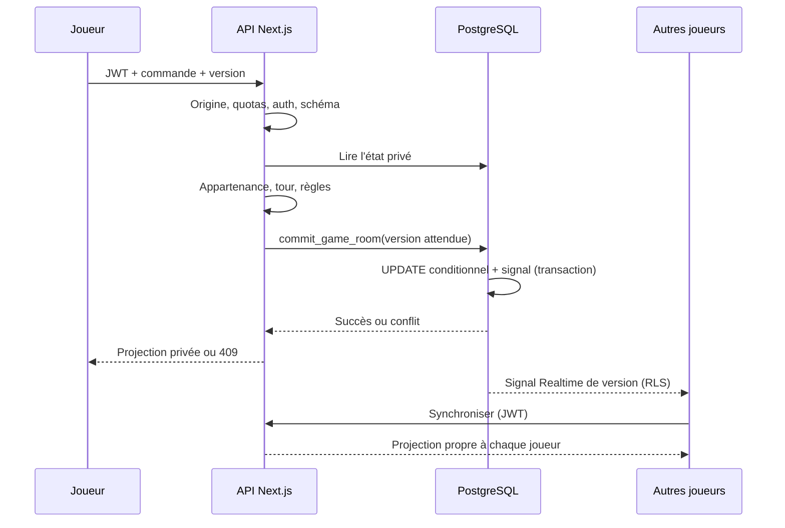

# Architecture

## Choix

- Next.js App Router : même projet pour UI et API HTTP, déploiement Vercel.
- Supabase Auth anonyme : identité persistante sans mot de passe. Le serveur utilise `auth.getUser(token)`, pas le décodage non vérifié d'un JWT.
- PostgreSQL : source d'autorité persistante de la partie. Pas d'état global en mémoire dans une fonction Vercel.
- Supabase Realtime : signal de version privé, puis lecture authentifiée de la projection. Une reconnexion ou un signal manqué est réparé par une nouvelle lecture.
- Zod : commandes strictes, sans champs d'état arbitraires.
- Moteur pur : testable sans Next, Supabase ou navigateur, partagé avec l'entraînement.

## Flux d'un coup

Un échec de transport après commit peut laisser le client incertain : resynchroniser avant de réessayer. L'ancienne version ne peut pas être appliquée deux fois. Les réponses de synchronisation plus anciennes que la version actuellement affichée sont ignorées.

## Données

| Table           | Données                                 | Accès client                          |
| --------------- | --------------------------------------- | ------------------------------------- |
| `game_rooms`    | État complet JSONB, version, expiration | Aucun                                 |
| `room_members`  | Couple salon / UUID auth                | Lecture de sa propre appartenance     |
| `room_events`   | Code, version et chat_revision          | Lecture des salons dont on est membre |
| `room_messages` | Messages du salon, auteur, date         | Aucun accès direct client             |
| `rate_limits`   | HMAC de clé, compteur, expiration       | Aucun                                 |

Toutes les tables ont RLS activé. Le serveur utilise un client Supabase privilégié sans persistance de session. Les fonctions SQL ne sont exécutables ni par `anon` ni par `authenticated`, seulement `service_role`. Elles sont `security invoker` avec `search_path` vide.

`create_game_room` crée état, membre et signal dans une transaction. `commit_game_room` modifie l'état seulement si la version attendue correspond, ajoute les nouveaux membres et met à jour le signal dans la même transaction. Deux jonctions concurrentes ou deux coups concurrents ne peuvent pas écraser l'autre.

## État de jeu

- `position = -1` : réserve.
- `0 .. L-1` : parcours commun ; `L = 16 × nombre de couleurs`.
- `L .. L+3` : maison propre à chaque couleur.
- `stake = true` : pieu protégé, pas encore déplacé.
- États : `exchange`, `play`, `finished`.
- `hands`, `deck`, `exchanges` ne figurent jamais dans la projection. `hand` désigne uniquement les cartes du demandeur ; les autres mains n'ont qu'un compteur.
- Coups proposés : séquences légales complètes, avec partitions ordonnées du 7. Le serveur revalide la séquence reçue sans faire confiance à l'UI.

Les numéros de couleur sont stables (rouge, jaune, bleu, vert, noir, blanc, violet, orange), leur ordre autour de la table met les partenaires face à face. Les UUID sont visibles entre membres de la partie dans les identifiants de joueurs ; ce sont des identifiants techniques, pas des jetons d'accès.

## Reconnexion et sessions

Supabase conserve la session anonyme dans le stockage du navigateur et rafraîchit son jeton. Après actualisation, ouvrir l'invitation et rejoindre restitue la place existante si le même utilisateur est identifié. Le code du salon doit être conservé ; il n'existe pas encore de liste des anciennes parties.

La requête `join` est idempotente pour un membre existant. L'identité ne dépend pas du pseudo, du code seul, de l'adresse IP ni d'un index de siège client. La perte du stockage local nécessite une nouvelle partie si la précédente est déjà commencée.

## Charge et évolution

Les états sont petits (jusqu'à 32 pions et 98 cartes). Les coups fractionnés sont calculés par exploration exhaustive bornée à quatre pions et sept pas. Les lectures sont limitées à 90/minute/utilisateur et 240/minute/IP. Le signal Realtime est complété par une lecture toutes les 15 secondes sur un onglet visible.

Seuls les salons explicitement publics sont listables, avec une projection limitee aux informations d'accueil. À grande échelle, mesurer le coût des quotas SQL, limiter en amont dans Vercel, mettre les lectures de commandes sous observabilité sans données privées et optimiser les partitions équivalentes du 7 si nécessaire. Toute évolution de protocole devrait introduire une version de schéma avant de faire cohabiter d'anciennes parties avec de nouvelles règles.

## Chat et bots

Le chat utilise `append_room_message`, réservé au serveur après vérification de l'identité et de l'appartenance. Un UUID rend les renvois du même message idempotents. `chat_revision` réveille les lecteurs sans modifier la version CAS du jeu. La base conserve 100 messages par salon, la projection en retourne 50. Aucun corps de message ne passe par Realtime.

Les bots sont des sièges du salon, jamais des identités Auth. Seul l'hôte les ajoute ou les retire avant le lancement. Un navigateur présent demande `bot-tick` ; le serveur vérifie le tour, calcule un seul coup et le sauvegarde par CAS. La stratégie reçoit une projection privée normale. Sans navigateur actif, les bots attendent. Le mode local utilise le même moteur.

`board-layout.ts` décrit les panneaux rectangulaires et leurs coordonnées. `turn-controls.tsx` regroupe main, sélection des pions, composition du 7 et validation. Les mises à jour du chat ne réinitialisent pas une sélection en cours.

## Liste publique et exclusion

`list_public_rooms` est une RPC serveur exclusive. Elle retourne au plus 30 salons publics non expires, non commences et non complets : code, pseudo du createur, capacite, occupation et option Joker. Aucun etat de jeu, UUID, message ou choix prive ne traverse ce contrat. La commande HTTP `list` exige une identite verifiee et les quotas habituels.

`kick` exige hote, salon non commence, siege invite humain et version attendue. Le commit CAS retire aussi les anciens `room_members` dans la meme transaction. `banned` reste serveur uniquement et bloque une nouvelle jonction par cette identite. Le chat verrouille la ligne salon avant de verifier l'appartenance pour serialiser ses envois avec une exclusion. Les salons historiques sans `public` restent prives.

`move-preview.ts` calcule uniquement des reperes graphiques a partir des mouvements deja autorises dans la projection. Cette aide ne remplace jamais la validation serveur.
